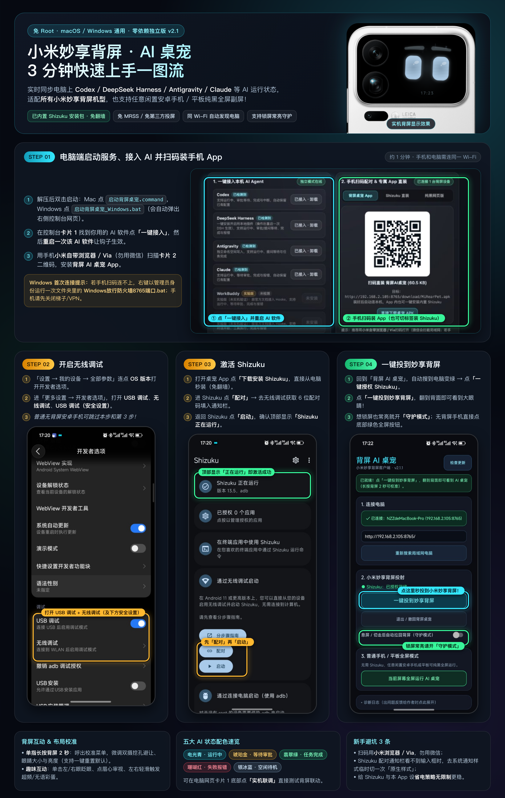

# 小米妙享背屏 · AI 桌宠状态屏（免 Root 独立版 v2.1 · 个人改造版）

> ## 原作者
>
> **抖音 @牛霸天手机** · GitHub [@nzz0991999-ai](https://github.com/nzz0991999-ai)
>
> 原始项目：**[nzz0991999-ai/xiaomi-rear-ai-pet](https://github.com/nzz0991999-ai/xiaomi-rear-ai-pet)**
>
> 这个仓库是原项目的**个人改造版**。设计思路、整体架构、绝大部分代码都属于原作者。
> 我只做了若干「实际用起来会踩到坑」的地方的修补，详见文末 [本仓库的改动](#本仓库的改动)。
>
> **请先去原仓库点 Star** —— 没有他，这个项目根本不存在。

---

免 Root、免第三方投屏工具（无需 MRSS / Webview Kiosk），把 **小米妙享背屏**（适配小米 17 / 17 Pro / 17 Pro Max / 18 Pro / 18 Pro Max 等所有妙享背屏机型，也支持任意闲置安卓手机 / 平板 / iPad 全屏副屏）改造成一块实时同步电脑 AI 编程助手运行状态的「拟人赛博大眼睛桌宠」。

- **支持主流 AI 编程助手**：**Codex**、**DeepSeek Harness (DSH)**、**Antigravity**、**Claude Code**，以及实验版 **WorkBuddy**、**Cursor** 和通用 Webhook。
- **零依赖跨平台**：电脑端仅需 Python 3 标准库（macOS / Windows 通用）；手机端内置 `60 KB` 专属客户端 + 官方 `Shizuku v13.6.0` 安装包。
- **支持云端自动更新**：后续发新版 Release 后，手机 App 打开会自动提示「✨ 发现新版本 · 点击立即更新」。

---

## 最爽玩法：把下面这句话直接发给你的 AI，让它全自动帮你装好

无论你用的是 **Codex、DeepSeek Harness、Claude Code、Antigravity、WorkBuddy 还是 Cursor**，直接把下面这句话发给你的 AI（仓库内置了专门给 AI 读的 [`AGENTS.md`](./AGENTS.md) 自动化操作手册）：

```text
帮我阅读 https://github.com/nzz0991999-ai/xiaomi-rear-ai-pet 里的 AGENTS.md，
自动帮我在电脑上部署小米妙享背屏 AI 桌宠并一键接入我当前使用的 AI 软件，
启动本地服务后，再一步一步教我在手机上完成连接和投屏！
```

---

## 3 分钟快速上手一图流



---

## 手动上手 4 步

> **下载方式**：前往本仓库 [Releases](../../releases) 下载打包好的 ZIP 解压，或 `git clone` 本仓库。

### 1. 启动电脑端（macOS / Windows 通用）

确保电脑装有 Python 3（macOS 自带，Windows 可在微软商店免费安装 Python 3）：

- **macOS**：双击 `启动背屏桌宠.command`
- **Windows**：双击 `启动背屏桌宠_Windows.bat`
  - *(Windows 首次运行若手机扫不到电脑，右键以管理员身份运行一次 `Windows放行防火墙8765端口.bat`)*

启动后浏览器会自动弹出本地控制台，照着页面操作即可。

> ⚠️ **端口占用检查**：`8765` 是很多工具（包括一些手机控制类脚本）的默认端口。
> 启动前先 `netstat -ano | findstr :8765` 看一眼，被占了就换端口，例如
> `python server.py --host 0.0.0.0 --port 8775`。

### 2. 一键接入电脑上的 AI 软件

在控制台 **卡片 1** 找到你正在使用的 AI 工具点 **「一键接入」**（原配置会自动备份，随时可一键卸载还原），然后**完全退出并重启一次该 AI 软件**生效。

- **Codex 用户额外一步**：新版 Codex 默认会拦截未信任的外部 Hook。完全重启 Codex 后，进入 **Codex 设置 → Hooks**（或在终端 Codex 输入 `/hooks`），把所有 **`Mi Rear AI Pet status`** 钩子点一遍信任即可开始实时同步（控制台卡片 1 也会自动检测并显示「待信任」提醒）。

### 3. 手机扫码安装 App

确保手机和电脑连在**同一个 Wi-Fi**（手机先关闭梯子/VPN）：

- 用**小米自带浏览器**或 **Via 浏览器**（不要用微信扫码）扫控制台 **卡片 2** 的二维码，安装 **背屏 AI 桌宠 (`MiRearPet.apk`)**；
- 打开 App 会自动搜到你的电脑并连上（显示绿色 `✓ 已连接`）。

> 自动发现走 UDP 广播，跨网段、跨路由器、校园网/公司网基本搜不到。
> **搜不到就手填地址**：卡片 1 输入框里直接写 `http://电脑IP:端口/`（末尾斜杠别丢），
> 输入即生效，没有保存按钮。

### 4. 一键投到小米妙享背屏（或任意手机全屏）

- **小米妙享背屏用户**：
  1. 仓库已内置官方 **Shizuku v13.6.0** 安装包：首次使用在手机 App 点 **「下载安装 Shizuku」** 直接从电脑局域网秒传安装（也可切到网页卡片 2 的「Shizuku 直装」二维码扫码装）；
  2. 展开 App 内自带的 3 步指引开启无线调试并启动 Shizuku（顶部显示「Shizuku 正在运行」）；
  3. 回 App 点 **「一键授权 Shizuku」** → 点 **「一键投到妙享背屏」**，翻到背面即可看到大眼睛！
  4. 如希望正面锁屏时背屏也常亮不退出，打开 **「守护模式」** 开关（并把 Shizuku 与本 App 省电策略设为无限制）。
- **普通安卓手机 / 平板用户**：不用装 Shizuku，直接点 App 底部的 **「当前屏幕全屏运行 AI 桌宠」** 即可纯黑无边框常亮运行。
- **iPhone / iPad 用户**：在电脑控制台卡片 2 切到「纯黑网页版」标签，用 Safari 扫码打开即可。

---

## 背屏校准、互动与排查

- **单击互动**：点左/右眼 Wink，点眉心雷达审视，左右轻滑触发超频/无语彩蛋。
- **双击右上角**：呼出「背屏布局校准」菜单，可微调左侧双摄挖孔避让、眼睛大小、OLED 亮度、空闲时钟，并支持一键 **「重置默认」**。
  > 本改造版**关闭了原来的「长按 2 秒」入口** —— 手握手机时拇指极易误触，详见改动说明。
- **扫码打不开 / 报 `ERR_TOO_MANY_RETRIES`**：改用小米自带浏览器或 Via，或在浏览器设置里关掉「安全 DNS / 始终使用安全连接」；macOS 请在「系统设置 → 隐私与安全性 → 本地网络」允许「终端」。
- **遇到问题反馈**：展开手机 App 最底部的 **「诊断日志」** 点 **「复制日志」**，在 Issues 贴出即可快速排查。

### 状态与外观对照

| 状态 | 眼睛 | 触发 |
|---|---|---|
| `idle` | 银蓝半眯，22 秒后睡着 | 无任务 |
| `running` | 电光青双眼 + 愤怒眉 | 有 turn 在跑 |
| `waiting_user` | 琥珀金 | 等你确认/授权 |
| `completed_unread` | 翡翠绿 + 月牙笑 + ✓✦◆ 粒子 | 任务完成（默认 60 秒后回落） |
| `failed` | 红色 | 任务失败（停留 300 秒） |

---

## 跨网络怎么连

手机和电脑不在同一个局域网时，有三条路：

| 方案 | 适合 | 代价 |
|---|---|---|
| **Cloudflare 临时隧道** | 零配置，`cloudflared tunnel --url http://127.0.0.1:端口` 立刻得到 `https://xxx.trycloudflare.com` | 地址随机，进程重启就换；国内时通时不通 |
| **Windows 移动热点**（WinRT） | 电脑能上网即可，手机连热点直连内网 `http://192.168.137.1:端口/` | 手机必须连这个热点 |
| **固定域名**（Named Tunnel） | 一次性配好永久固定 | 需要一个托管在 Cloudflare 的域名 |

> ⚠️ **两条重要经验**：
>
> 1. **cloudflared 的 quick tunnel 会缓冲 SSE 长连接** —— 手机能连上、也显示「已连接」，但状态永远不动。
>    本改造版加了轮询兜底（详见改动说明），原版遇到这个现象会以为是手机的问题。
> 2. **启动脚本必须存成 GBK(936) + CRLF**。中文 Windows 的 `cmd.exe` 按 936 读 `.bat`，
>    存成 UTF-8 会让中文路径全变问号、`%变量%` 变乱码、Python 掉进交互模式。

---

## 本仓库的改动

相对原作者版本，这个仓库修正了以下问题（所有改动都在**实际设备上跑通验证过**）：

### 网页端（`web/index.html`）

1. **SSE 轮询兜底** —— cloudflared quick tunnel 会缓冲 `/api/events` 的 SSE 流，
   手机只在首帧拿到一次状态、之后永不更新（但服务端 `connected_phones` 仍显示 1，极具欺骗性）。
   现在：SSE 6 秒无消息就自动降级为 3 秒一次 `/api/status` 轮询；连续 4 次失败后彻底停掉重连，
   不再每 2 秒重连烧电。局域网内仍优先走 SSE。
2. **省电：帧率闸门** —— `idle` 时 10fps、活跃时 45fps（原来恒定 60fps）。
   背屏是 OLED 且长期常亮，这一项直接砍掉大半 GPU 开销。
3. **省电：WakeLock 按状态申请/释放** —— 原来页面一加载就 `navigator.wakeLock.request("screen")` 并且永不释放，
   熄屏永远不会发生。现在只在非 `idle` 状态持有，`idle` 立刻释放，跟随系统息屏。
4. **关闭长按 2.2 秒的校准入口** —— 手握手机时拇指压在背屏上极易误触弹出设置面板。
   现在只有**双击右上角 64×64 热区**能打开（需要恢复长按，把那段注释解开即可）。

### 服务端（`server.py`）

5. **修复 `getfqdn` 卡死启动** —— `http.server.HTTPServer.server_bind()` 会调 `socket.getfqdn(host)`
   做反向 DNS。在 DNS 不通的环境（校园网、离线、某些企业网）会卡 30 秒以上，
   表现为「进程活着但端口不监听、不报错不退出」。
   现在 `QuietThreadingHTTPServer` 重写了 `server_bind()` 跳过反向解析。
6. **完成态 TTL 可调** —— `completed_unread` 的停留时间从 300 秒改成 **60 秒**，好让背屏早点回到待机。

### 安卓端（`android/`，重打包为 v2.1.9）

7. **锁屏状态下守护失效** —— `RearGuardService.maybeRepin()` 开头有一段
   `if (km.isKeyguardLocked()) return;`，锁屏时整条守护链直接退出，连通知栏的「立即拉回背屏」都绕不过。
   去掉这个判断后，锁屏双击背屏 4 秒内自动拉回。
8. **清后台后不自愈** —— 新增一个空 `AccessibilityService`（`KeepAliveService`）作为保活锚点。
   无障碍服务由系统 `AccessibilityManagerService` 绑定，LMK 基本不杀；
   它在 `onServiceConnected()` 里自己 `startForegroundService(RearGuardService)`，
   并从 `SharedPreferences("mi_rear_pet")` 读回 url / display_id，避免落到默认的 `127.0.0.1:8765` 空界面。
9. **不再弹主界面** —— `RearShellHelper` 每次投屏都会执行
   `am start --display 0 -n pkg/.MainActivity --activity-reorder-to-front`，
   把你 App 的卡片列表拉到主屏前台。整段删除。
   > 顺便记一笔：**不要**把 `--display 0` 改成背屏 id 图省事 ——
   > 下游 `moveRootTaskToTaskDisplayArea` 是按「任务在主屏」查 rootId 的，
   > 改了上游会 `IllegalArgumentException: Unknown rootTaskId` 崩掉整条守护链。
10. **主屏闪黑屏** —— `RearPetActivity` 在主屏创建时会显示「正在投射到背屏...」。
    三步走：`setBackgroundColor(0xFF000000)` → `0x0`（只改 DecorView，不够）→
    `statusOverlay` 改 `GONE`（字没了，底还黑）→
    Manifest 加 `android:theme="@android:style/Theme.Translucent.NoTitleBar"`（**这才是根治**）。
    前两步不生效的原因：`setBackgroundColor(0)` 改不动窗口 Surface，它仍标着 `PixelFormat.OPAQUE`。

### 运维脚本（新增）

11. `keepalive.py` —— 每 20 秒检查 server 和 cloudflared，缺了自动拉起（`DETACHED_PROCESS`）。
12. `notify_tunnel.py` —— 监视 `tunnel.log`，临时域名一变就发消息通知。
13. `watch_domain.py` —— 轮询 DoH 检查域名 NS 是否已切到 Cloudflare。
14. `setup_fixed_domain.ps1` —— 一键把 quick tunnel 切成 Named Tunnel 固定域名。
15. `部署提示词_给别人.md` / `.txt` —— 把整套部署流程（含上面所有坑）写成给 AI 读的提示词，
    丢给任何 AI 都能照着装好。

---

## 已知限制

- **临时隧道地址会变**：`cloudflared` 重启就换新域名，必须重新填 App。要固定请走 Named Tunnel。
- **校园网/公司网通常开 AP 隔离**：手机和电脑在同一网段也互相 ping 不通，只能走隧道或热点。
- **背屏熄屏后守护不拉回是设计如此**：背屏 Doze 时主动唤醒会烧电，需要熄屏常亮请调长背屏息屏时间。
- **清后台（Force Stop）必然断开**：Android 的 Force Stop 会清掉所有服务，包括无障碍服务，
  只有重新打开 App 才能恢复。普通「最近任务划掉」不在此列。

---

## 开源许可

本项目基于 [MIT License](./LICENSE) 开源，**原始版权归 [@nzz0991999-ai](https://github.com/nzz0991999-ai)（抖音 @牛霸天手机）所有**。
内置的 [Shizuku](https://github.com/RikkaApps/Shizuku) 官方安装包遵循 Apache-2.0 协议。
